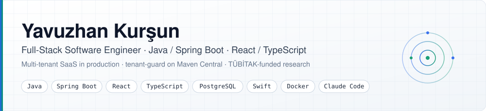

<picture>
  <source media="(prefers-color-scheme: dark)" srcset="assets/header-dark.svg">
  <source media="(prefers-color-scheme: light)" srcset="assets/header-light.svg">
  
</picture>

  
  
  
  

  <b>Istanbul, Türkiye</b> · Open to relocating to <b>Stockholm, Sweden</b> (work permit required) · Open to remote, hybrid and on-site roles

---

Full-stack software engineer focused on **Java / Spring Boot** and **React / TypeScript**. I built a multi-tenant financial SaaS from scratch and run it in production, published [tenant-guard](https://github.com/yavuzhankursun/tenant-guard), an open-source library that catches cross-tenant data leaks, on Maven Central, and led a TÜBİTAK-funded research project on time-series forecasting. I design systems with security as a constraint, not an afterthought, and I have used AI-assisted engineering workflows (Claude Code) daily in production for over 1.5 years.

B.Sc. in Software Engineering, Kocaeli Health and Technology University (2026).

## Highlights

- **Shipped a multi-tenant SaaS to production.** [Zecrone](https://zecrone.com) is a bookkeeping platform companies use to manage invoicing, inventory, customer/supplier accounts, cash/bank and reporting. Java 21, Spring Boot 3, React 18, PostgreSQL, Redis, ActiveMQ Artemis, React Native, Docker, Azure. 54 API controllers, 69 UI components, 27 Flyway migrations.
- **Designed the tenant-isolation security model** behind it: JWT-based isolation, PostgreSQL row-level security and versioned schema migrations. Then turned the lesson into a library.
- **Published tenant-guard on Maven Central.** It detects forgotten tenant filters from inside PostgreSQL during tests. 33 leak patterns, 584 tests, 97% mutation score, CI matrix across PostgreSQL 13–17 and Spring Boot 3.2–3.5.
- **Won a competitive national research grant (TÜBİTAK 2209-A)** as Principal Investigator for forecasting exchange rates, inflation and interest rates. Packaged the modeling pipeline as a reusable Python library.
- **Built an end-to-end-encrypted, local-first finance app** (Kumbara) for iPhone and Mac: custom sync engine (hybrid logical clock, outbox, field-level LWW, WebSocket, ChaCha20-Poly1305), p95 sync latency of 320 ms over the real internet, zero-cost backend on Cloudflare Workers and Durable Objects, 230+ tests.

## Featured Projects

| Project | What it is | Stack |
|---|---|---|
| [**tenant-guard**](https://github.com/yavuzhankursun/tenant-guard) | Test library that catches cross-tenant data leaks in Spring/JDBC apps from inside PostgreSQL (RLS observer policy + JDBC proxy + before/after diff). Maven Central, Apache-2.0. | Java 21, JDBC, Testcontainers, JUnit 5, GitHub Actions |
| [**Zecrone**](https://github.com/yavuzhankursun/on-muhasebe-showcase) | Multi-tenant SaaS accounting platform, live at [zecrone.com](https://zecrone.com). Architecture and documentation showcase (source is private). | Spring Boot 3, React 18, React Native/Expo, PostgreSQL, Redis, ActiveMQ |
| [**Aegis**](https://github.com/yavuzhankursun/Aegis) | Native macOS 26 control center: battery health and wear forecast, memory/CPU/energy telemetry, safe trash-only cleanup. No dependencies, no network, no sudo. `brew install yavuzhankursun/tap/aegis` | Swift 6, SwiftUI, Liquid Glass |
| [**Turkish Economic Forecasting**](https://github.com/yavuzhankursun/turkish-economic-forecasting) | TÜBİTAK 2209-A research: USD/TRY, inflation and policy-rate forecasting with hybrid ARIMA models and news sentiment. All models under 10% MAPE. | Python, ARIMA/SVR, NLP, React dashboard |
| [**Electricity & Carbon Forecasting**](https://github.com/yavuzhankursun/Machine-Learning-Based-Electricity-Consumption-Forecasting-and-Carbon-Footprint-Analysis) | B.Sc. thesis: three-stage pipeline forecasting Türkiye's electricity demand and CO₂ footprint for 2026–2030 with seven models (R² 0.9738, MAPE 2.57%). [Interactive dashboard](https://github.com/yavuzhankursun/tez-enerji-karbon-dashboard). | Python, LSTM, XGBoost, ARIMA, Optuna, SHAP |
| [**Monster**](https://github.com/yavuzhankursun/claude-app) | Native macOS client for Claude Code: drives the CLI as a subprocess over stream-json, with a UI-independent Swift engine package. | Swift 6, SwiftUI, SwiftData |
| [**Sade Home**](https://github.com/yavuzhankursun/TV-LAUNCHER) | Lightweight Android TV launcher with a built-in AirPlay receiver, zero third-party dependencies, ~250 KB APK. | Kotlin 2.0, Android TV |
| [**AI Image Classifier**](https://github.com/yavuzhankursun/ai-image-classifier) | 10-class animal classifier with MobileNetV2 transfer learning and a Streamlit web UI. | Python, TensorFlow, Streamlit |

## Tech Stack

<table>
  <tr>
    <td><b>Languages</b></td>
    <td>
      
      
      
      
      
      
    </td>
  </tr>
  <tr>
    <td><b>Backend</b></td>
    <td>
      
      
      
      
      
      
      
      
      
    </td>
  </tr>
  <tr>
    <td><b>Frontend &amp; Mobile</b></td>
    <td>
      
      
      
      
      
      
      
    </td>
  </tr>
  <tr>
    <td><b>DevOps &amp; Testing</b></td>
    <td>
      
      
      
      
      
      
      
      
    </td>
  </tr>
  <tr>
    <td><b>Data &amp; ML</b></td>
    <td>
      
      
      
      
    </td>
  </tr>
  <tr>
    <td><b>AI-Assisted Development</b></td>
    <td>
      
      
    </td>
  </tr>
</table>

## Experience

| Period | Role | Company |
|---|---|---|
| Feb 2026 – May 2026 | Full-Stack Software Engineer (long-term internship) — built Zecrone from scratch, designed its tenant-isolation security model, delivered invoicing, inventory, accounts and reporting modules, added caching and message-queue infrastructure, shipped the mobile app and the cloud deployment. | Multitek Elektronik, Istanbul |
| 2024 – 2026 | VoIP and Systems Engineer (part-time) — enterprise PBX systems on Issabel 5 / Asterisk, real-time call-center-to-CRM integrations, operator-panel UI work and Turkish localization (React, TypeScript, Vite). | Open Teknoloji, Mersin |
| Summer 2025 | Software Engineering Intern — web management panel for a cloud-based smart-home automation product family. | Multitek Elektronik, Istanbul |
| Summer 2024 | Software Engineering Intern — replaced a manual spreadsheet-based monthly reporting process with KPI and financial-status dashboards (Power BI). | Kanık Şirketler Grubu, Kocaeli |

## Research

- **Forecasting Economic Indicators with Machine Learning (TÜBİTAK 2209-A), Principal Investigator.** Competitive national research grant from the Scientific and Technological Research Council of Türkiye. End-to-end time-series study of exchange rates, inflation and interest rates. [Repository](https://github.com/yavuzhankursun/turkish-economic-forecasting)
- **B.Sc. Thesis: Electricity Consumption Forecasting and Carbon Footprint Analysis.** Forecast Türkiye's electricity consumption and carbon footprint for 2026–2030 with LSTM, Random Forest, XGBoost and ARIMA. Best model: 2.57% MAPE, 0.9738 R². [Repository](https://github.com/yavuzhankursun/Machine-Learning-Based-Electricity-Consumption-Forecasting-and-Carbon-Footprint-Analysis)

## Writing

- [Catching the forgotten tenant filter from inside the database](https://medium.com/@ykurrsun/8c81babb7a4a) (Turkish) — the story behind tenant-guard.

## Contact

**Email:** [ykurrsun@gmail.com](mailto:ykurrsun@gmail.com) · **LinkedIn:** [yavuzhan-kursun](https://www.linkedin.com/in/yavuzhan-kursun) · **Medium:** [@ykurrsun](https://medium.com/@ykurrsun) · **HackerRank:** [ykurrsun](https://www.hackerrank.com/ykurrsun)

Languages: Turkish (native), English (professional working proficiency).
